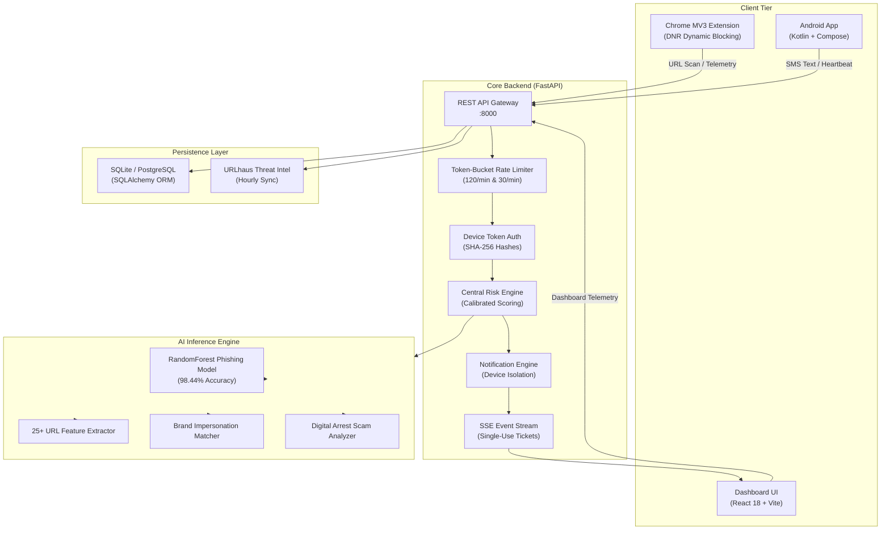

# 🛡️ CYBER RAKSHA AI (साइबर रक्षा)
> **AI-Powered Proactive Digital Fraud Detection & Prevention Ecosystem**  
> *Native Android Protection • Chrome MV3 Shield • Intelligent Risk Evaluation • Real-Time Alert Engine*

[](https://github.com/rahulmaster994-star/Cyber-Raksha-AI)
[-brightgreen)](backend/tests/)
[](docs/TESTING_REPORT.md)
[](browser_extension/tests/)
[](https://www.python.org/)
[](https://fastapi.tiangolo.com)
[](android/)
[](browser_extension/)
[-orange)](docs/B4_1_DETECTION_INTELLIGENCE_AUDIT.md)
[](#)

---

## 1. Project Overview

**Cyber Raksha AI** is a multi-platform cybersecurity ecosystem built to protect citizens and organizations from modern social engineering and digital fraud attacks across browsers, mobile devices, and telecommunications.

### Protection Capabilities:
1. **Phishing & Deceptive URLs:** Supervised Random Forest lexical and structural analyzer with 25+ extracted features (133ms CPU inference).
2. **Brand Impersonation Detection:** Levenshtein edit-distance matching protecting major Indian banks (SBI, HDFC, ICICI, PNB) and public utilities.
3. **SMS Smishing Protection:** Multi-pattern category detection identifying coercive urgent demands, lottery lures, and fake KYC notices.
4. **Digital Arrest Scam Shield:** Detection of forged law enforcement notices (CBI, ED, Cyber Police) demanding video interrogation or funds transfers.
5. **Fake Courier / Delivery Scams:** Detection of spoofed courier tracking alerts (India Post, BlueDart, DTDC).
6. **Legitimate OTP & Transaction Guards:** False-positive suppression for genuine debit notifications and two-factor authentication codes.
7. **Threat Intelligence Synchronization:** Automated ingestion of high-confidence indicators from open-source feeds (URLhaus).
8. **Browser Extension Shield:** Chrome MV3 Declarative Net Request (DNR) dynamic rule generation blocking malicious navigation.
9. **Android Security Suite:** Native Kotlin + Jetpack Compose application with AndroidKeyStore AES-256-GCM encrypted token storage.
10. **Unified Incident Management:** Cross-vector corroboration, incident state tracking, and live Server-Sent Events (SSE) streaming.

---

## 2. System Architecture



---

## 3. Technology Stack

| Component | Technologies |
|---|---|
| **Backend API** | Python 3.11–3.13, FastAPI, Uvicorn, Pydantic v2, SQLAlchemy |
| **AI / Machine Learning** | Scikit-learn (RandomForestClassifier), NumPy, Joblib |
| **Android Application** | Kotlin, Jetpack Compose, Retrofit, Room DB, WorkManager, AndroidKeyStore |
| **Browser Extension** | Chrome Manifest V3, Declarative Net Request (DNR), Service Workers |
| **Frontend Dashboard** | React 18, TypeScript, Vite, Tailwind CSS, Lucide Icons |
| **Security & Cryptography** | HMAC-SHA256 (Pepper rotation), AES-256-GCM, SHA-256 Token Hashing |
| **Database** | SQLite (Development) / PostgreSQL (Production) |

---

## 4. Quick Start (Local Setup)

### Prerequisites
- Python 3.11+
- Node.js 18+ and npm
- JDK 17+ (for Android builds)
- Google Chrome (for extension)

### 1. Launch Backend API
```powershell
# In PowerShell:
cd c:\Users\RAHUL\OneDrive\Desktop\cyberRaksha
.\start_cyberraksha.ps1
```
*API will run on `http://127.0.0.1:8000` (Docs at `http://127.0.0.1:8000/docs`).*

### 2. Launch Dashboard UI
```powershell
cd frontend
npm install
npm run dev
```
*Dashboard will open on `http://localhost:5173`.*

### 3. Load Chrome Browser Extension
1. Open Chrome and navigate to `chrome://extensions/`.
2. Toggle on **Developer mode** in the top right corner.
3. Click **Load unpacked** and select the folder:
   `c:\Users\RAHUL\OneDrive\Desktop\cyberRaksha\browser_extension`

### 4. Build Android APK
```powershell
cd android
.\gradlew.bat assembleDebug
```
*APK generated at `android/app/build/outputs/apk/debug/app-debug.apk`.*

---

## 5. Verification & Testing

Execute the test suites across all platforms:

```powershell
# 1. Backend Tests (371 tests, 100% pass)
python -m pytest backend/tests -q --tb=short

# 2. Browser Extension Tests (27 tests, 100% pass)
cd browser_extension
node tests/test_rules_manager.js
node tests/test_notifications.js
node tests/verify_a1_deep_audit.js

# 3. Android Unit Tests
cd ../android
.\gradlew.bat testDebugUnitTest

# 4. Frontend Production Build
cd ../frontend
npm run build
```

---

## 6. Project Documentation Index

Comprehensive engineering documents are located in [`docs/`](docs/):
- [docs/FINAL_RELEASE_AUDIT.md](docs/FINAL_RELEASE_AUDIT.md) — Complete release audit and verification matrix.
- [docs/SYSTEM_ARCHITECTURE.md](docs/SYSTEM_ARCHITECTURE.md) — Mermaid architecture diagrams and database ER models.
- [docs/INSTALLATION_GUIDE.md](docs/INSTALLATION_GUIDE.md) — Detailed deployment and installation instructions.
- [docs/DEPLOYMENT_GUIDE.md](docs/DEPLOYMENT_GUIDE.md) — Zero-cost cloud deployment guide (Render, Vercel, Neon).
- [docs/API_DOCUMENTATION.md](docs/API_DOCUMENTATION.md) — REST API endpoint specification.
- [docs/TESTING_REPORT.md](docs/TESTING_REPORT.md) — 16 end-to-end scenario verification results.
- [docs/SECURITY_REPORT.md](docs/SECURITY_REPORT.md) — Threat model, cryptography, and vulnerability audit.
- [docs/KNOWN_LIMITATIONS.md](docs/KNOWN_LIMITATIONS.md) — Operational boundaries and hardware requirements.
- [docs/CHANGELOG.md](docs/CHANGELOG.md) — Version release history.

---

## 7. Known Limitations & Operational Boundaries

1. **Android SMS Mode:** Operates in user-submitted/manual mode (`SmsAccessMode.MANUAL_ONLY`). Automatic background SMS interception is not implemented in this release.
2. **Inference Latency:** Warm CPU inference is ~133 ms on Windows 11 hardware.
3. **URL Shorteners:** URLs using `bit.ly` or `tinyurl.com` are flagged as `SUSPICIOUS_SHORTENER`; automatic HTTP redirect following is omitted to prevent SSRF vulnerabilities.
4. **Multi-Process Concurrency:** SQLite is configured for single-instance development; production should use PostgreSQL via `DATABASE_URL`.

---

## 8. License

This project is licensed under the Apache License 2.0. See [LICENSE](LICENSE) for details.
