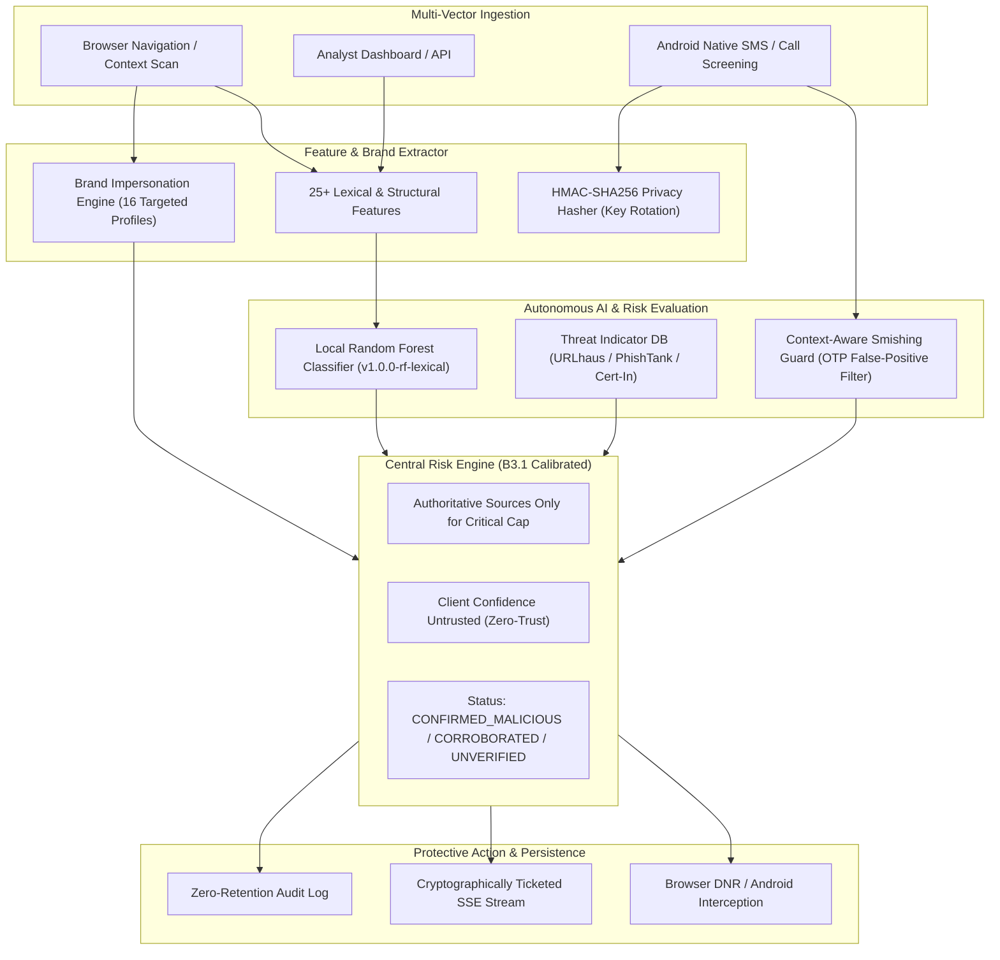

# Cyber Raksha AI — Phase B4: Intelligent Threat Detection Architecture

## 1. System Overview & Architectural Paradigm

Phase B4 transforms Cyber Raksha AI from a reactive indicator-matching framework into an autonomous, intelligence-driven cybersecurity ecosystem capable of detecting zero-day phishing infrastructure, lookalike brand impersonation, deceptive shorteners, and coercive smishing campaigns without relying on pre-existing threat database records.

The architecture operates strictly within a **zero-budget, privacy-preserving, CPU-executable local paradigm**. It requires:
- Zero paid API keys or subscription services
- Zero mandatory cloud dependencies
- Zero network exfiltration of raw SMS or credentials
- Zero hardcoded detection outcomes

---

## 2. URL Feature Extraction Pipeline (25+ Dimensions)

Feature extraction executes completely offline in `< 2.5ms` per URL, evaluating lexical patterns, character distributions, and structural abnormalities:

1. **Length Dimensions**: `url_length`, `domain_length`, `path_length`, `tld_length`
2. **Character Frequencies**: `dot_count`, `hyphen_count`, `underscore_count`, `slash_count`, `question_mark_count`, `equal_count`, `at_symbol_count`, `percent_count`, `special_char_count`, `consecutive_char_run`
3. **Digit-to-Letter Distribution**: `digit_count`, `letter_count`, `digit_to_letter_ratio`
4. **Structural & Network Properties**:
   - `subdomain_count` (derived using ccTLD and multi-level domain boundaries)
   - `has_ip_address` (validates both raw IPv4 and bracketed IPv6 hostnames)
   - `is_https` (distinguishes transport layer encryption)
   - `has_at_symbol` (identifies URL userinfo embedding tricks)
   - `has_suspicious_port` (flags non-standard ports outside 80, 443, 8080, 8443)
   - `query_param_count` (analyzes URL parameter entropy)
   - `is_punycode_or_idn` (detects internationalized homoglyph attacks using `xn--`)
5. **Semantic Keywords**: `suspicious_keyword_count` scanning for banking, login, KYC, and credential tokens.

---

## 3. Brand Impersonation & Lookalike Domain Engine

Autonomous brand impersonation detection recognizes fraudulent infrastructure before third-party feeds publish indicators. It monitors 16 high-value target profiles across 5 categories:

- **Banking**: HDFC Bank, State Bank of India (SBI), ICICI Bank, Axis Bank, Kotak Mahindra Bank, Punjab National Bank (PNB)
- **Payment & FinTech**: Paytm, PhonePe, Google Pay (GPay)
- **Logistics & National Postal**: India Post / Speed Post, Blue Dart Express
- **Technology & Streaming**: Amazon, Netflix
- **Government Portals**: Income Tax Department (e-Filing), UIDAI (Aadhaar)

### Impersonation Detection Algorithm:
1. **Official Infrastructure Whitelist**: Validates if the domain is an authorized host or subdomain (e.g., `onlinesbi.sbi`, `myaadhaar.uidai.gov.in`). If matching official infrastructure, analysis immediately confirms legitimacy.
2. **Unauthorized Keyword Probing**: Detects brand keywords embedded inside third-party domains as standalone tokens, hyphenated prefixes/suffixes (`sbi-netbanking-update.xyz`), or unauthorized subdomains.
3. **Risk Scoring Contribution**: Injects structured evidence directly into the central risk engine (+35.0 for banking, +30.0 for fintech, +25.0 for logistics/government).

---

## 4. Context-Aware SMS Smishing Guard

Smishing detection evaluates multi-vector signals with context awareness:

- **OTP False-Positive Safeguard**: Differentiates between authentic bank transaction receipts ("Your OTP for Rs 1500 is 123456. Do not share.") and harvesting attacks ("Share your OTP with the bank manager to verify KYC"). Benign receipts are protected from false-positive flags.
- **Digital Arrest Extortion Detection**: Identifies extortion language simulating CBI, Police, Narcotics, Customs, and Court warrants.
- **Delivery & Customs Scams**: Intercepts fake package holds and address update demands.
- **Zero-Retention HMAC Hashing**: Hashes normalized message contents with server-side pepper keys, supporting zero-downtime key rotation via historical peppers.

---

## 5. Central Unified Risk Engine (B3.1 Calibrated)

The Central Risk Engine (`CentralSecurityRiskEngine`) unifies signals across Web, Android, and AI models:
- **Zero-Trust Client Confidence**: Client-supplied numerical confidence is untrusted; authority is strictly conferred if `source_name in AUTHORITATIVE_SOURCES`.
- **Heuristic Cap Enforcement**: Purely heuristic signals cannot exceed `HIGH` severity. `CRITICAL` severity is reserved exclusively for corroborated authoritative feeds or confirmed active attacks.
- **Classification & Verification Status**:
  - `CONFIRMED_MALICIOUS`: Corroborated authoritative feed match with `CRITICAL` severity.
  - `CORROBORATED`: Authoritative intelligence without immediate critical threat tier.
  - `UNVERIFIED_HEURISTIC`: ML model or rule-derived verdict pending external feed corroboration.

