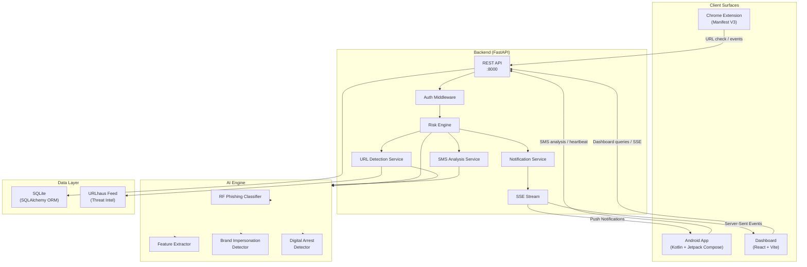
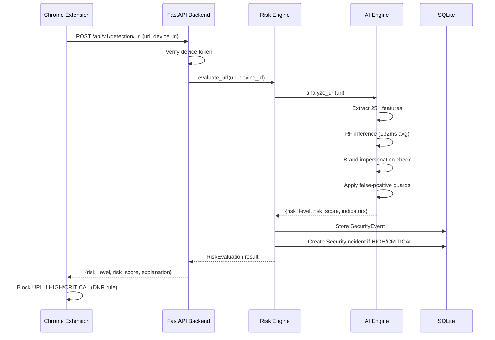
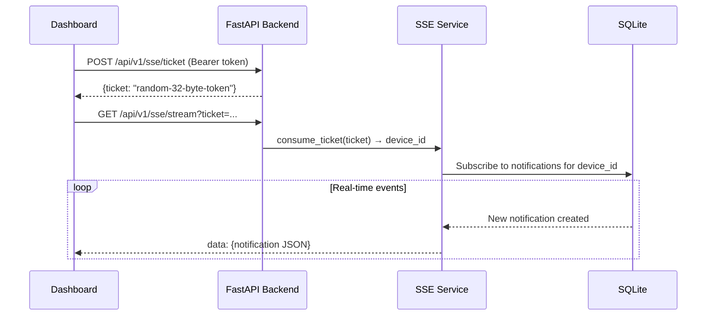
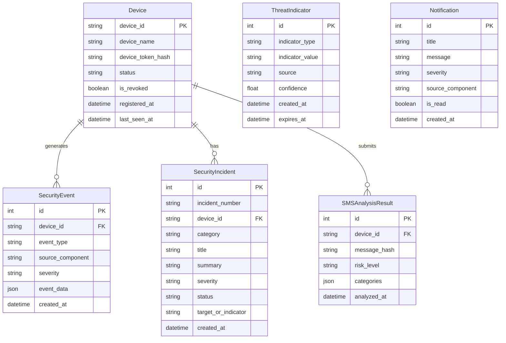

# Cyber Raksha AI — Final System Architecture

**Version:** B4.1 Final  
**Date:** 2026-11-10  

---

## 1. System Overview

Cyber Raksha AI is a multi-platform proactive digital fraud protection ecosystem. It protects users from phishing, smishing, voice fraud, brand impersonation, digital arrest scams, UPI fraud, and malicious URLs across four surfaces:

1. **Web browsing** — Chrome extension with real-time URL blocking
2. **SMS protection** — Android app with smishing detection
3. **Call protection** — Android call screening service
4. **Centralized intelligence** — Backend with AI engine and threat intelligence

---

## 2. High-Level Architecture



---

## 3. Component Details

### 3.1 Backend (FastAPI)

| Module | Path | Responsibility |
|--------|------|---------------|
| Main app | `backend/app/main.py` | ASGI entry point, middleware registration |
| Auth middleware | `backend/app/middleware/auth_middleware.py` | Device token verification |
| Rate limiter | `backend/app/middleware/rate_limiter.py` | 120 req/min general, 30 req/min heavy |
| Central risk engine | `backend/app/services/central_risk_engine.py` | Unified risk scoring across all inputs |
| SMS analysis | `backend/app/services/sms_analysis_service.py` | Smishing detection, HMAC deduplication |
| URL detection | `backend/app/services/url_analysis_service.py` | Phishing URL analysis |
| Device service | `backend/app/services/device_service.py` | Registration, heartbeat, isolation |
| Incident service | `backend/app/services/incident_service.py` | SecurityIncident lifecycle |
| Notification service | `backend/app/services/notification_service.py` | Alert persistence and delivery |
| Ticket service | `backend/app/services/ticket_service.py` | Single-use SSE tickets (60s TTL) |
| Threat intel sync | `backend/app/services/threat_intel_service.py` | URLhaus synchronization |

### 3.2 AI Engine

| Module | Path | Responsibility |
|--------|------|---------------|
| Engine | `ai_engine/core/engine.py` | Orchestration and false-positive guards |
| Prediction | `ai_engine/core/prediction.py` | ML inference + calibrated risk scoring |
| Feature extraction | `ai_engine/core/features.py` | 25+ lexical and structural URL features |
| Brand impersonation | `ai_engine/core/brand_impersonation.py` | Edit-distance brand matching (22 brands) |
| Digital arrest | `ai_engine/core/digital_arrest.py` | Keyword-based scam pattern detection |
| SMS analyzer | `ai_engine/core/sms_analyzer.py` | Category classification, OTP guard |
| Training | `ai_engine/training/train_model.py` | RandomForest training on 1600-URL dataset |

### 3.3 Browser Extension

| File | Responsibility |
|------|---------------|
| `manifest.json` | MV3 manifest, permissions |
| `background/service_worker.js` | DNR rule management, threat sync |
| `background/threat_sync.js` | URLhaus synchronization (hourly) |
| `background/notifications.js` | Chrome notification dispatch |
| `content/content_script.js` | Page-level URL scanning |
| `popup/popup.html` | Extension popup UI |

### 3.4 Android Application

| Component | Responsibility |
|-----------|---------------|
| `MainActivity.kt` | Navigation, Compose entry point |
| `DeviceRegistrationViewModel.kt` | Registration, heartbeat |
| `SmsAnalysisViewModel.kt` | SMS fraud analysis UI |
| `SmsReceiver.kt` | Broadcast receiver for incoming SMS |
| `CallScreeningService.kt` | Call reputation checking |
| `SecureTokenManager.kt` | KeyStore AES-256-GCM token storage |
| `ApiService.kt` | Retrofit HTTP client |

### 3.5 Frontend Dashboard

| Component | Responsibility |
|-----------|---------------|
| `SecurityOverview.tsx` | Threat summary cards |
| `ActivityMonitor.tsx` | Real-time security event feed |
| `IncidentManagement.tsx` | Incident list, details, actions |
| `NotificationCenter.tsx` | Alert management |
| `ThreatIntelligence.tsx` | URLhaus sync status |
| `api.ts` | Typed API client with all interfaces |

---

## 4. Data Flow Diagrams

### 4.1 URL Analysis Flow



### 4.2 SMS Analysis Flow

```mermaid
sequenceDiagram
    participant AND as Android App
    participant API as FastAPI Backend
    participant SMS as SMS Service
    participant AI as AI Engine

    AND->>API: POST /api/v1/sms/analyze {message_hash, features, device_id}
    API->>SMS: analyze_sms(features)
    SMS->>SMS: Category detection (UPI, KYC, Digital Arrest, etc.)
    SMS->>SMS: OTP false-positive guard
    SMS->>AI: analyze_urls(extracted_urls)
    AI-->>SMS: URL threat results
    SMS-->>API: {risk_level, categories, url_threats}
    API-->>AND: Analysis result + recommended action
```

### 4.3 SSE Notification Flow



---

## 5. Database Schema



---

## 6. AI Model Architecture

### RandomForest Phishing Classifier

| Property | Value |
|----------|-------|
| Algorithm | RandomForestClassifier (scikit-learn) |
| Trees | 100 |
| Features | 25+ lexical + structural URL features |
| Training data | 1600 URLs (800 phishing + 800 legitimate) |
| Inference time | ~133ms warm (CPU, Windows 11, AMD/Intel) |
| Model file | `ai_engine/models/phishing/phishing_classifier.joblib` |

### Feature Categories

| Category | Features |
|----------|---------|
| URL structure | Length, subdomain count, path depth, query params |
| Lexical | Digit ratio, hyphen count, special char ratio |
| Domain | TLD type, age indicators, entropy |
| Security | HTTPS presence, port number, IP address usage |
| Brand signals | Known brand keyword presence |
| Threat intel | URLhaus match, OpenPhish match |

### Calibrated Risk Scoring

```
risk_score = min(100, (
    indicator_score +           # 0–55 from deceptive indicators
    ml_contribution +           # 0–25 from ML (capped when 0 indicators)
    threat_intel_score +        # 0–20 from URLhaus/OpenPhish
    brand_impersonation_score   # 0–30 from brand matching
))
```

False-positive guards:
- When zero deceptive indicators: ML contribution capped at 25% of full weight
- `.gov.in`, `.gov`, `.mil` with zero indicators: phishing_prob capped at 0.05
- Legitimate OTP receipts: `credential_harvest` category excluded

---

## 7. Security Architecture

| Layer | Control |
|-------|---------|
| Device authentication | SHA-256 token hash + constant-time compare |
| Data isolation | Row-level device_id filter + 403 on mismatch |
| SMS privacy | HMAC-SHA256 (rotating pepper); content never stored |
| SSE security | Single-use 60s ticket; replay rejected |
| Android storage | KeyStore AES-256-GCM |
| Rate limiting | 120/min general, 30/min heavy endpoints |
| SQL injection | SQLAlchemy ORM; no raw string interpolation |
| Browser extension | MV3 CSP; no eval; DNR (not webRequest) |

---

## 8. Deployment Architecture (Development)

```
Windows 11 Machine
├── Backend: uvicorn 127.0.0.1:8000
├── Frontend: Vite dev server localhost:5173
├── Chrome: Extension loaded unpacked
└── Android Device / Emulator
    └── Connects via local network IP:8000
```

Production deployment would add: HTTPS termination (nginx/caddy), PostgreSQL, Redis (rate limiter), process manager (systemd/PM2).

